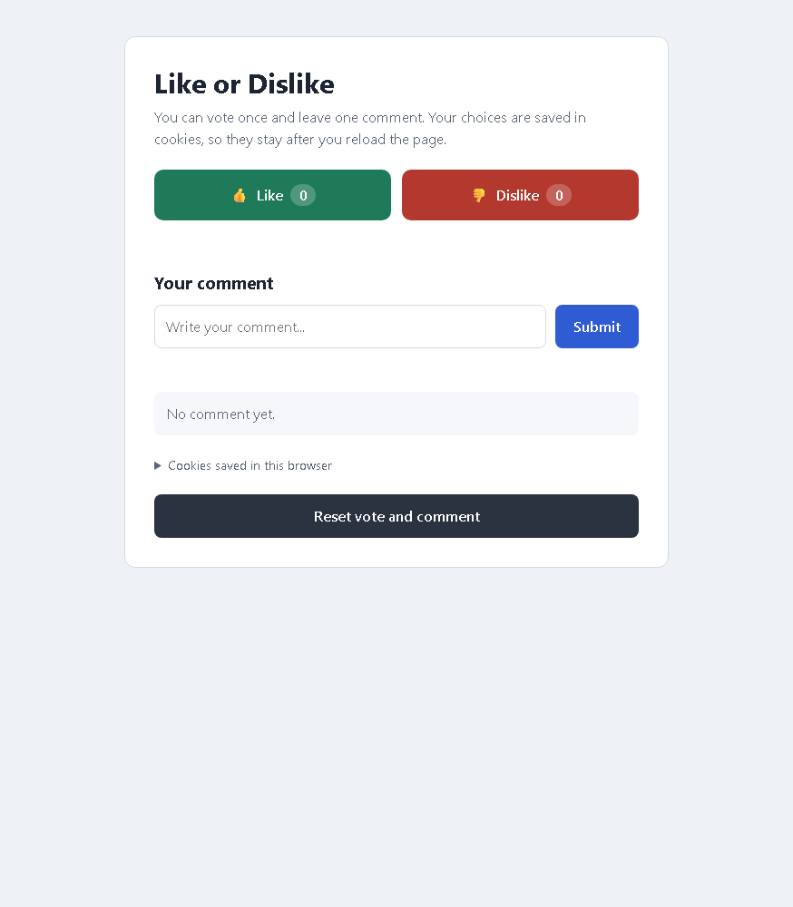

# CPIT-405 - Lab 6: Cookies

| | |
|---|---|
| **Student** | Fahad Alshehri |
| **ID** | 2338900 |
| **Course** | CPIT-405 |

## Task

A Like / Dislike page with a comment box that uses cookies:

- The user can vote **Like** or **Dislike** only once.
- The user can leave only **one** comment.
- The vote, the counts and the comment are saved in cookies, so they stay after the page is reloaded.
- A **Reset** button deletes the cookies so the user can vote and comment again.

## Files

- `index.html` - the page
- `style.css` - the styles
- `script.js` - the cookie helpers (`setCookie`, `getCookie`, `deleteCookie`) and the page logic

## Cookies used

| Cookie | Value |
|---|---|
| `vote` | `like` or `dislike` |
| `likes` | number of likes |
| `dislikes` | number of dislikes |
| `comment` | the comment as JSON: `{"text": "...", "date": "..."}` |

The page also has a "Cookies saved in this browser" section that shows these values.

## How to run

Open the page through a web server, for example with the **Live Server** extension in VS Code (right-click `index.html` > Open with Live Server).

Chrome and Edge do not save cookies for a page opened straight from the file (`file://`). If you open it that way, the page shows a warning and the vote and comment are lost when you reload.

